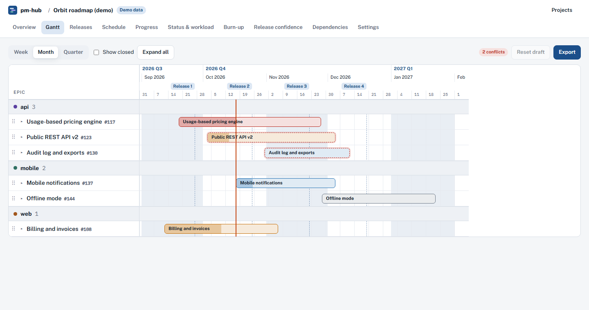
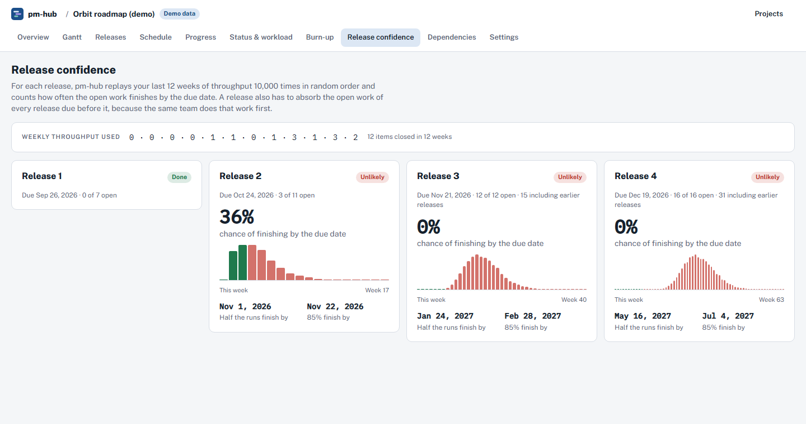

# pm-hub

Roadmaps, Gantt charts and delivery forecasts for any GitHub Project, and a fast way to keep the plan current as it changes. It runs entirely in your browser.

**Open it:** https://nfbutt.github.io/pm-hub/ · or [try the demo project](https://nfbutt.github.io/pm-hub/#/demo/gantt) without a token.



## What it does

Pick one of your GitHub Projects. pm-hub reads its items, field values, milestones, sub-issues and "blocked by" links, then shows:

| View | What you see |
|---|---|
| Overview | Counts, how the project's fields were interpreted, open epics with progress |
| Gantt | Epics as bars in swimlanes, release markers, conflict flags. Drag to move or resize, drag a story onto another epic, draw a dependency between bars, rename in place, add stories |
| Plan | An editable table of epics and their stories: inline cells, multi-select bulk edits, copy and paste between cells |
| Releases | One column per milestone or iteration, with what ships and how much is done |
| Schedule | Calendar of due dates, sprint starts and epic starts and ends |
| Progress | Each epic's work done against how much of its time has passed |
| Status & workload | Status counts, open work per person per week, items missing dates or owners |
| Burn-up | Scope and completed work per week, throughput, projected finish |
| Release confidence | Monte Carlo forecast: chance of hitting each due date, plus the dates half and 85% of runs finish by |
| Dependencies | Graph of blocked-by and parent links, critical path, cycles |
| Epic Map | Epics as bubbles of tasks: overlaps, misplaced tasks, kinds of work with no epic, a structure score; drag tasks between epics; a deck of suggestions you can accept or turn down |
| Settings | Change how dates, epics, swimlanes, releases and priority are read; fiscal-year quarters |
| Review | Every pending change with before and after, checked against GitHub, then applied |

### Works with any project

pm-hub detects how a project is set up and lets you change it:

- **Bar dates:** a start/end date-field pair, an iteration field, or the milestone due date. Epics without dates use the span of their sub-issues.
- **Epics:** issues with sub-issues, the issue type "Epic", or a label like `type: epic`.
- **Swimlanes:** any single-select field, or a label prefix such as `product:`. GitHub Projects itself can't group by labels.
- **Releases:** milestones, an iteration field, or a single-select field.

## Changing the plan

Epics and stories change all the time: they get re-dated, re-scoped, split, moved between epics and blocked by new work. pm-hub is built so that keeping up is quick and safe.

- **Edit anywhere.** The item drawer edits every field (title, status, priority, lane, release, sprint, owners, labels, dates, parent epic, blockers) and can close, split, promote to epic or add a story. The Gantt and the Plan table edit in place. **Ctrl/Cmd+K** opens a command menu that acts on whatever is selected; `[` and `]` shift the selection a week.
- **Dependents follow.** When you move a bar, items blocked by it move only if they would overlap (default), keep their gap, or stay put.
- **Every edit is a recorded change.** Undo and redo with Ctrl+Z and Ctrl+Shift+Z. The counter in the top bar shows net changes (dragging a bar ten times is one change). "GitHub only" hides your changes.
- **Scenarios.** Keep several versions of the plan side by side ("Plan A: hire earlier", "Plan B: cut scope"), each with its own history.
- **Review, then apply.** *Review* lists every change with before and after. pm-hub first re-reads the affected items: anything someone changed on GitHub in the meantime is flagged and left out unless you choose to overwrite it. When a target date moves more than three days you can say why, and the reason is posted as a comment on the issue. You can also post a project status update. Each change reports applied, failed or skipped; failures stay in your draft to retry, and *Prepare a revert* queues the exact undo.
- Lane order and parking stay in pm-hub; GitHub has no place for them.

### Plan history

- **Baselines** are snapshots of the plan: each item's dates, epic, state, release and lane. Save one at any review ("Q1 plan"); pm-hub also saves one automatically right before every apply.
- **What changed** compares today's plan (optionally with your unapplied changes) against any baseline: items added, removed, slipped or pulled in (with days), moved between epics, closed, renamed or re-released. It also lists the epics whose end date keeps moving across baselines, epics that gained stories after they started, and a feed of every apply with who did it, each change's result and the reasons given.
- **Compare to** on the Gantt draws a baseline as dashed outlines behind the bars, labelled with how many days each item has slipped (+) or been pulled in (−). Epics that gained stories after starting carry a "+N since start" badge.
- History is kept in your browser by default. **Settings → History** can share it instead through a repo you choose: pm-hub then writes small JSON files under `.pm-hub/<owner>-<project>/` (`baselines/` and `changes/`, plus a README). Files are only ever added, never edited, so two people can't overwrite each other. Saving history never blocks an apply; if it fails, the review screen says so.

## How the forecasts work

- **Progress** compares the share of an epic's sub-issues that are closed with the share of its time window that has passed. More than 10 points behind the clock is *Behind*; more than 25 is *At risk*.
- **Burn-up** projects the remaining work at the average pace of the last six full weeks. Epics are left out because they close when their parts do.
- **Release confidence** replays the last 12 weeks of throughput 10,000 times in random order (seeded, so results are repeatable) and reports how often the open work finishes by each due date. A release also carries the open work of every release due before it, because the same team does that work first. Thin history is flagged.
- **Critical path** is the longest chain of open work through "blocked by" links, weighted by remaining days. Loops where items block each other are found with Tarjan's algorithm.



## Your token and your data

- Create a **classic** personal access token with `project` and `repo`, plus `read:org` for organization projects. [This link pre-fills those scopes.](https://github.com/settings/tokens/new?scopes=project,repo,read:org&description=pm-hub) A token with only `read:project` works for planning, but can't apply changes.
- The token is sent **only** to `api.github.com`, in a request header. A Content-Security-Policy in the built page blocks every other destination except Google Fonts.
- By default the token is kept in `sessionStorage` and forgotten when you close the tab. "Remember on this device" keeps it in `localStorage`.
- Project data is cached in your browser's IndexedDB so the next visit is instant. There is no server, no database and no analytics.
- pm-hub writes to GitHub **only** when you press Apply on the review screen, or save history to a repo you chose. Every project and issue write lives in `src/github/mutations.ts` and is sent only by `src/github/apply.ts`; history files are written only by `src/github/contents.ts`, through the contents API. `test/write-guard.test.ts` enforces all three.
- Loading a project costs about 35 GraphQL points per 100 items, out of GitHub's 5,000 per hour. A warning appears when fewer than 500 remain.

### A model on your own computer (optional)

The Epic Map can ask a model running on **your** machine to compare work by meaning, name what an epic is really about, explain an overlap, and suggest epics that are missing. It is off until you turn it on in *Settings → Local model*.

- **Nothing leaves your computer.** The address has to be `localhost` or `127.0.0.1`; anything else is refused before a request is made.
- **Only issue text goes to the model**: titles and bodies, plus the epic titles and the words two epics share. **Your GitHub token is never part of a request**, and no project metadata, file or repository is sent.
- Embeddings and answers are cached in your browser's IndexedDB, so the model is asked once per item, not once per visit.
- If the model is slow, unreachable or answers something that does not make sense, pm-hub quietly falls back to its own analysis.
- The built page's Content-Security-Policy allows `http://localhost:*` and `http://127.0.0.1:*` in `connect-src`, and nothing else.

Ollama refuses browser calls from another origin unless you allow this page. Start it with:

```bash
OLLAMA_ORIGINS=https://nfbutt.github.io ollama serve
```

Then run `ollama pull qwen3` and `ollama pull qwen3-embedding`, and set the address to `http://localhost:11434/v1` in *Settings → Local model*. LM Studio and llama.cpp's server work the same way.


## Develop

```bash
npm install
npm run dev        # http://localhost:5173/pm-hub/
npm test           # unit tests on a synthetic project (src/demo/fixture.ts)
npm run build      # typecheck + production build into dist/
```

Optional check against a real project. It loads the project, renders every view in memory, prints a summary and writes nothing to disk:

```bash
PM_HUB_TOKEN=$(gh auth token) PM_HUB_PROJECT=owner/number npx vitest run test/live.test.tsx --silent=false
```

To test real writes, point a separate check at a throwaway project titled exactly "pm-hub sandbox" (it refuses any other). It applies one change of every kind, reads them back, then reverts them all:

```bash
PM_HUB_TOKEN=$(gh auth token) PM_HUB_SANDBOX=owner/number npx vitest run test/live-write.test.ts --silent=false
```

Tests, screenshots and the demo use synthetic data only. Never commit real project snapshots.

## Layout

```
src/github/   GraphQL client, queries, loader, mutations and the apply engine
src/model/    pure logic: normalize, mapping, schedule, health, forecast, deps,
              ops (the change list), edits (intentions to ops), scenarios,
              diff (baselines, churn)
src/store/    browser cache, preferences, plan history (local or in a repo)
src/views/    one component per view
src/ui/       design tokens, shell, drawer, SVG charts
src/demo/     synthetic fixture used by tests and demo mode
```

Pushing to `main` deploys to GitHub Pages (`.github/workflows/pages.yml`). Every PR runs typecheck, tests and a build (`.github/workflows/ci.yml`).

## License

MIT
